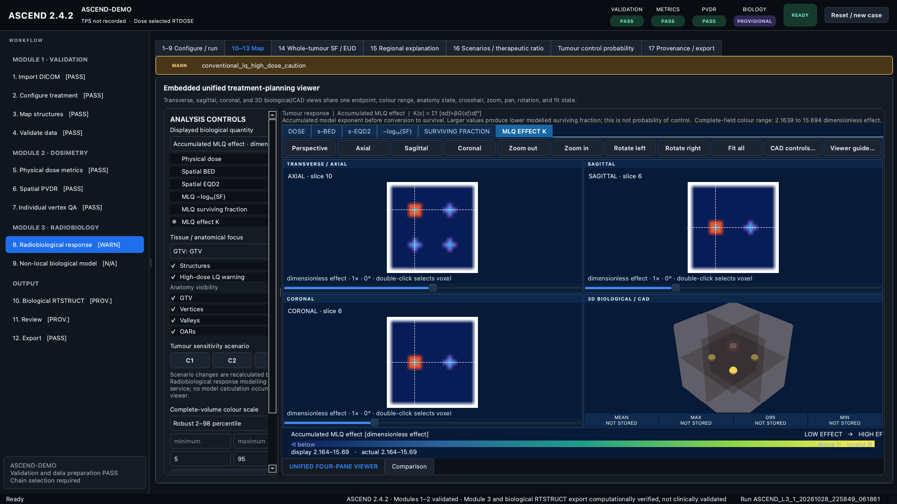
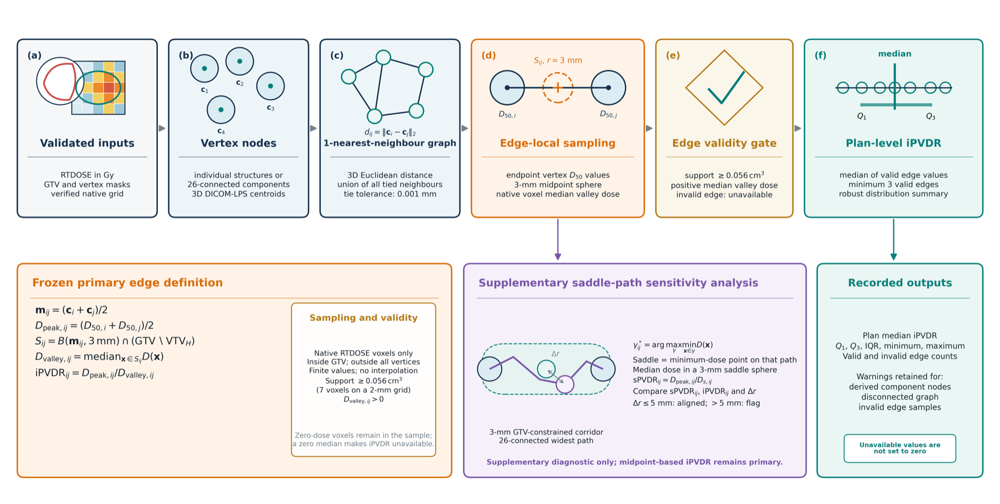

# ASCEND — Independent Radiotherapy Plan Evaluation

**Current release:** 2.4.2  
**Source:** [github.com/kaiwooodger/ASCEND](https://github.com/kaiwooodger/ASCEND)  
**Status:** Research software; not approved for clinical decision-making

## 1. Problem definition

Radiotherapy research workflows often distribute validation, dosimetry, spatial analysis, biological modelling and reporting across independent scripts. This weakens state control, provenance and reviewability. ASCEND consolidates the workflow while retaining a strict boundary between physical calculations, research models and clinical claims.

The system addresses five connected problems:

1. verification of the selected DICOM relationship chain and treatment context;
2. reproducible physical lattice radiotherapy dosimetry;
3. spatial peak-to-valley and individual-vertex quality analysis;
4. research radiobiology with explicit model status and warnings;
5. provenance-controlled reporting and release identity.

## 2. Methods and architecture

ASCEND uses three ordered modules:

- **Validation:** imports DICOM, verifies object identity and geometry, binds external TPS DVH evidence, maps structure roles and creates a canonical native-dose archive.
- **Dosimetry:** calculates locked physical metrics, spatial PVDR, dose-gradient evidence, saddle evidence and vertex-level QA.
- **Radiobiology:** calculates LQ/MLQ response, tumour and normal-tissue summaries, TCP and an optional hypothesis-generating non-local model.

The workstation is stateful. Disabled actions indicate unmet prerequisites. Adjacent warning panels name the correction. Exported results retain the software version, full commit, configuration hash and parameter-set identities.

The spatial iPVDR method constructs a nearest-neighbour graph from validated vertex nodes. It samples a defined edge-local valley region between each connected vertex pair, rejects invalid edges and reports distribution summaries without replacing unavailable values with zero.

## 3. Implementation

| Area | Implementation |
| --- | --- |
| Desktop application | Python 3.11+, Qt 6 / PySide 6 |
| Medical data | DICOM-RT relationship, identity, geometry and native-grid dose handling |
| Scientific services | Numerical dosimetry, graph sampling, radiobiological response and reporting |
| Repository organisation | Installable application, tests, schemas, synthetic references, benchmarks, tools and documentation |
| Automation | GitHub Actions for tests, package checks, portability and release contracts |

Repository evidence at release 2.4.2 includes 166 Python application files, 44 automated test files, 84 technical documentation files and four GitHub workflow files. The current checkout collects and passes 395 tests plus 40 subtests.

## 4. Verification and validation

| Evidence | Quantitative result | Boundary retained |
| --- | --- | --- |
| Current automated suite | 395 tests and 40 subtests passed on macOS ARM64 with Python 3.12 | Local verification; not a substitute for the hosted portability matrix |
| Cross-platform CI | 229 tests and 28 subtests passed on each of six configurations: Linux x64, Windows x64 and macOS ARM64 with Python 3.11 and 3.12 | The retained matrix predates later expansion to 395 tests; offscreen rendering does not prove every hardware GPU or interactive desktop combination |
| Frozen numerical comparison | 14 metrics across five candidate configurations produced 70 baseline comparisons: 69 exact and one within tolerance | Maximum absolute difference was 8.881784197001252e-16 and maximum relative difference was 1.7760835124330015e-16 |
| Eclipse DVH benchmark | One stored case covered nine structures and 36 comparison records; 28 were valid comparisons, 24 passed and four failed | All 19 available dose comparisons passed; five of nine volume comparisons passed; eight D2 records were not assessed because no stored ASCEND endpoint was available |

The Eclipse dose benchmark used the provisional rule `abs(ASCEND - Eclipse) <= max(0.2 Gy, 2% of Eclipse)`. Across the 19 available dose comparisons, the median absolute difference was 0.00643 Gy and the maximum was 0.22245 Gy. The four preserved failures were structure-volume comparisons under the separate `max(0.1 cc, 2%)` rule. These failures and unavailable D2 endpoints remain visible rather than being excluded from the result.

Unit, integration, GUI, release-contract and portability tests are separated by purpose. Synthetic DICOM fixtures support repeatable geometry and state-machine regression. Package and repository-boundary checks verify release identity, documentation and data-exposure rules. Managed auxiliary cERT dose preserves separate LRT and cERT fraction histories and records bounded interpolation or coordinate-identity attestations. ASCEND performs no image registration or deformation.

The current evidence boundary is recorded in the repository’s `validation/` and `docs/` directories. Module 3 outputs remain computational research models rather than clinically validated predictions.

## 5. Results and limitations

ASCEND demonstrates the integration of DICOM data structures, numerical methods, graphical workflow design, testing, release engineering and evidence-led reporting in one working system.

Established results include:

- 395 tests and 40 subtests passing in the current checkout;
- six verified operating-system and Python configurations in the retained portability matrix;
- 70 frozen cross-platform numerical comparisons with maximum absolute drift of 8.88e-16;
- 19 of 19 available Eclipse dose comparisons passing the provisional agreement rule;
- physical lattice metrics, spatial iPVDR, dose-gradient and vertex-QA outputs;
- provenance-preserving structured export and human-readable reporting;
- research radiobiology separated from clinically validated functions;
- public source, technical documentation and reproducible validation assets.

Limitations remain active:

- research software only;
- no treatment planning, delivery or patient-management approval;
- no image registration or deformation;
- biological outputs require independent experimental and clinical validation;
- Eclipse evidence is currently one stored case, eight D2 endpoints remain unassessed and four of nine structure-volume comparisons fail the provisional criterion;
- external TPS and commissioned-system evidence remains necessary where a claim depends on it.

[Back to portfolio](../README.md)
