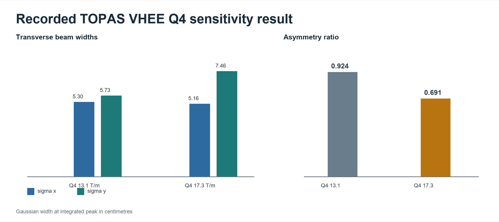
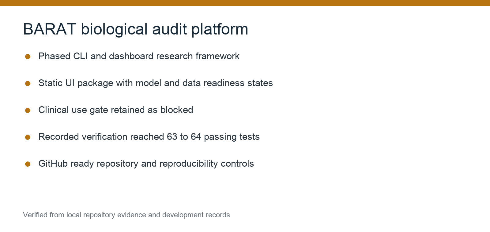
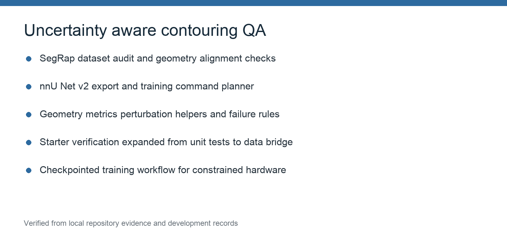

# Additional Engineering Projects

These projects extend the portfolio beyond the three principal research systems. Their development records are summarised in the [technical portfolio PDF](../CV.pdf).

## TOPAS VHEE beamline modelling

### Problem

Recreate and analyse a four-quadrupole asymmetric very-high-energy electron beamline at 100, 200 and 250 MeV, with emphasis on source and quadrupole sensitivity.

### Implementation

TOPAS input generation was paired with Python analysis for energy and Q4 sweeps, integrated depth metrics, transverse Gaussian widths, reproducible manifests and plotting.

### Quantitative result

At the integrated peak for the recorded 250 MeV comparison, the Gaussian width ratio changed from 0.924 at Q4 = 13.1 T/m to 0.691 at Q4 = 17.3 T/m. The analysis separated transverse asymmetry from one-dimensional percentage depth dose, which cannot demonstrate lateral asymmetry by itself.

### Boundary

Simulation output requires commissioned measurements and site-specific beam evidence before clinical interpretation.

## BARAT biological audit platform

### Problem

Create a phased research framework for biological plan audit with explicit model and data readiness states.

### Implementation and evidence

The project combined a command-line workflow with a static dashboard package, calibration lock, model-trust status, plan comparison and report export. Archived verification reached 63–64 passing tests. The clinical-use gate remained blocked.

## Uncertainty-aware contouring QA

### Problem

Evaluate automatic contours using stability and plausibility evidence in addition to average overlap.

### Implementation and evidence

The scaffold included geometry metrics, controlled perturbations, failure rules, SegRap geometry auditing, an nnU-Net v2 export bridge, training command planning and checkpointed workflows for constrained hardware. Development advanced from unit-test scaffolding to a 120-pair data audit and bridge verification.

### Boundary

The archived project record does not establish trained-model performance or clinical contour approval.

[Back to portfolio](../README.md)
