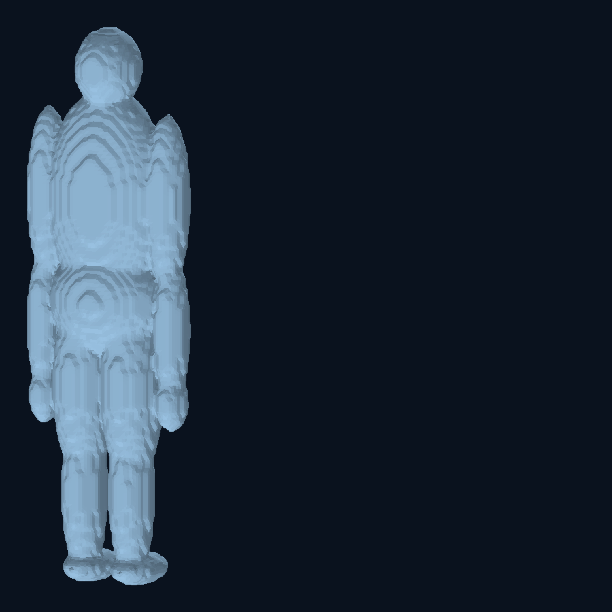
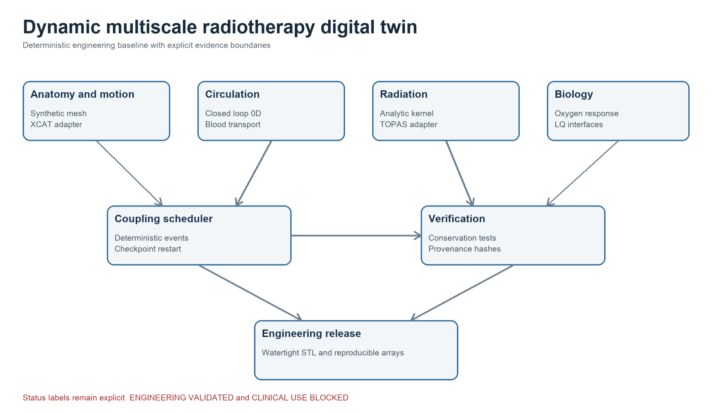

# Patient-specific Radiotherapy Digital Twin

**Release baseline:** v0.1.0 engineering-validated; later external-reference adapters and coupling gates developed separately  
**Status:** Engineering validated under declared fixtures; clinical use blocked

## 1. Problem definition

A radiotherapy digital twin must couple anatomy, motion, physiological transport, radiation and biological response without hiding unit, coordinate, timing or evidence assumptions. The project converts a broad multiscale specification into deterministic modules with typed data contracts, checkpointable execution and validation gates.

The target is an auditable research platform. The current release is not a patient-specific clinical model.

## 2. Methods and architecture

The implemented baseline contains:

- synthetic whole-body anatomy in right-handed DICOM-LPS millimetre coordinates;
- invertible respiratory and cardiac deformation;
- closed-loop 0D systemic and pulmonary circulation;
- flow-weighted blood-packet transport and dose history;
- mass-conservative lymph transport;
- analytic radiation verification and TOPAS adapter boundaries;
- perfusion-coupled oxygen and biological-response interfaces;
- uncertainty propagation, event scheduling, random streams and restart checkpoints.

External reference layers are gated independently. Passing one layer never grants a claim that belongs to another.

## 3. Implementation

The project is implemented as a modular Python package with configuration-driven runs, NumPy result arrays, STL outputs, JSON evidence records and Makefile entry points for reproduction and benchmarks.

Every run records source and input hashes, versions, random seed and artifact hashes. Units are explicit: anatomy uses millimetres; fluid variables use SI internally; radiation energy uses joules; absorbed dose uses grays.

## 4. Verification and validation

The immutable v0.1.0 engineering release produced:

- a 39,664-triangle full-body mesh;
- zero boundary, non-manifold or degenerate elements;
- eight passing release tests;
- byte-identical simulation arrays, summaries and STL across a clean rerun.

Subsequent work added:

- a 20-seed HEDOS comparison at field and DVH boundaries using 100,000 particles per seed;
- XCAT adapter intake and known-transform criteria;
- a locked TOPAS smoke case and adapter evidence;
- synthetic stationary and moving-dose coupling checks;
- conservation, zero-dose, static-limit, refinement and checkpoint/restart tests.

The later repository reached 65 passing tests during authorised XCAT intake. Actual XCAT execution remained blocked by provider licensing and platform requirements.

## 5. Results and limitations

The project establishes deterministic engineering behaviour under synthetic and manufactured references. It demonstrates multiscale coupling, explicit coordinate and unit contracts, restart reproducibility and evidence-gated development.

It does not establish:

- patient anatomical realism;
- human cardiovascular or lymphatic accuracy;
- commissioned radiation accuracy against measurement;
- calibrated biological response;
- external validation on frozen independent patients.

Those claims require authorised reference data, commissioned systems and independent evidence. `CLINICAL_USE_BLOCKED` remains active.

[Back to portfolio](../README.md)
