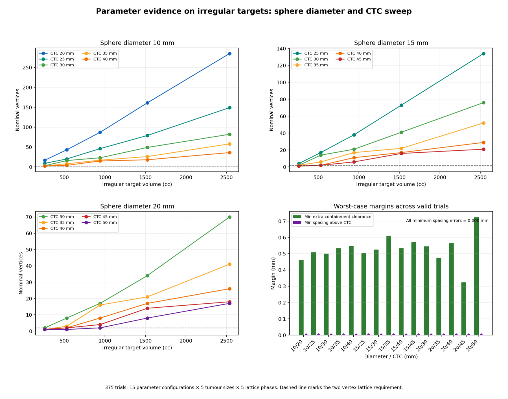

# ESAPI Lattice Sphere Placement

**Source:** [github.com/kaiwooodger/ESAPI-Script](https://github.com/kaiwooodger/ESAPI-Script)  
**Language:** C#  
**Environment:** Varian Eclipse Scripting API boundary

## 1. Problem definition

Manual placement of three-dimensional lattice vertices is repetitive and geometrically sensitive. The script automates Gaudreault-style sphere placement within a target while preserving the original structure and enforcing target contraction, image bounds, pair spacing, containment, output naming and cleanup rules.

## 2. Methods and architecture

The engine generates candidate lattice coordinates, rejects candidates that violate the contracted-target or image-volume boundary and creates individual control structures plus a union structure. The algorithm retains atomic failure behaviour so an invalid run does not leave partial outputs.

## 3. Implementation

- C# implementation structured around ESAPI geometry and structure-set interfaces.
- Shared geometry compiled directly from the deployed source for independent local testing.
- Synthetic irregular targets and a worked analytic phantom provide an inspectable non-Eclipse verification path.
- Existing output identifiers trigger a pre-modification failure.

## 4. Verification and validation

The independent parameter sweep covered 15 sphere-diameter/centre-to-centre configurations, five target sizes and five lattice phases: 375 trials in total.

| Measure | Recorded result |
| --- | ---: |
| Valid lattices | 336 |
| Correct no-lattice outcomes | 39 |
| Geometric failures | 0 |
| Worst spacing error | 0.000000 mm |
| Minimum containment clearance | 0.324 mm |
| Maximum tested lattice | 292 vertices |
| Core regression suite | 19 passed |

A worked 15 mm sphere, 40 mm centre-to-centre phantom produced 13 complete spheres with a 40.000000 mm minimum pair distance.

## 5. Results and limitations

The evidence establishes local geometric correctness across the tested synthetic domain. The original GTV remains unchanged and output collision is detected before modification.

Compilation and execution against the installed Varian assemblies inside a licensed Eclipse environment remain installation-specific validation steps. Local geometry verification does not establish clinical workflow approval.

[Back to portfolio](../README.md)
