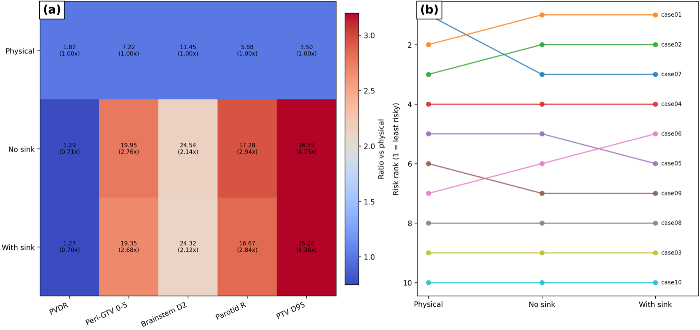
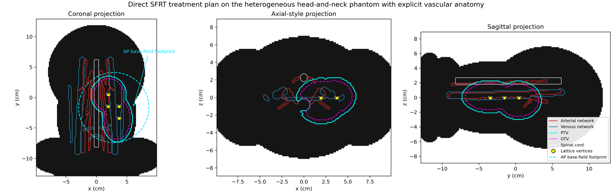

# Non-local Radiobiological Modelling

**Publication:** Woodger K. “Biology-informed reinterpretation of lattice radiotherapy using non-local bystander signalling and anatomy-aware vascular sink modelling.” *Physics in Medicine & Biology*. 2026;71(16).  
**DOI:** [10.1088/1361-6560/ae94dd](https://doi.org/10.1088/1361-6560/ae94dd)  
**PubMed:** [PMID 42551488](https://pubmed.ncbi.nlm.nih.gov/42551488/)  
**Reproducibility package:** [github.com/kair98-boop/SFRT](https://github.com/kair98-boop/SFRT)

## 1. Problem definition

Lattice radiotherapy is commonly evaluated using physical target coverage, peak-to-valley dose ratio and organ-at-risk dose. Those metrics do not explicitly model non-local radiation signalling. The study tests whether the interpretation and ranking of synthetic head-and-neck lattice dose patterns are retained after non-local signalling and anatomy-aware vascular uptake are introduced.

The intended use is hypothesis generation. It is not a clinical outcome predictor or treatment-selection system.

## 2. Methods and architecture

TOPAS-derived dose distributions were evaluated on a body-aware, smoothed Monte Carlo dose substrate. A reaction–diffusion model propagated ROS-like and cytokine-like fields. Explicit vessel masks produced an anatomy-aware vascular sink field.

The model was calibrated once using a one-dimensional half-field assay, then transferred without geometry-specific retuning to stripe, lattice, irregular-surrogate and synthetic head-and-neck geometries.

A 10-case algorithmic cohort was evaluated in three modes:

1. physical-only interpretation;
2. biology-informed interpretation without vascular uptake;
3. biology-informed interpretation with anatomical vascular uptake.

## 3. Implementation

The reproducibility repository contains:

- Python generators, transport wrappers, biological solvers, endpoint extraction and figure scripts;
- TOPAS templates and locked transport parameters;
- YAML snapshots for biology, vascular sink, uncertainty and cohort settings;
- manuscript-facing figure and table outputs;
- a bounded paper-regeneration smoke check;
- endpoint, figure and parameter manifests.

The public package excludes oversized raw transport intermediates while retaining scripts and curated outputs required to inspect the workflow and regenerate the publication-facing evidence.

## 4. Verification and validation

Verification included:

- transfer from the calibration geometry without case-specific retuning;
- repeated-run Monte Carlo uncertainty;
- sink falsification controls;
- smoothing-kernel sensitivity;
- bounded biology-parameter robustness;
- figure, table, endpoint and parameter manifests;
- a scripted paper-artifact regeneration check.

In repeated runs, 65 of 70 sink-related endpoint shifts exceeded the combined 95% Monte Carlo plus uptake-sensitivity band. No case produced a noise-qualified sink-driven rank change.

## 5. Results and limitations

In the oxygen-neutral primary cohort, the cohort-mean PVDR-like ratio changed from 1.817 under physical-only interpretation to 1.292 without vascular uptake and 1.270 with anatomical uptake. Biology-informed reinterpretation changed ranking in 5 of 10 cases for no-sink versus physical-only, 6 of 10 for with-sink versus physical-only and 2 of 10 for with-sink versus no-sink. Brainstem-adjacent biology-added burden flags occurred in 2 of 10 cases.

The defensible interpretation is that the non-local biology layer dominated reinterpretation while vascular uptake acted as a weaker secondary perturbation.

The work does not establish clinical benefit. It requires patient-derived RTDOSE/RTSTRUCT data, realistic vascular segmentation and independent experimental validation before clinical use.

[Back to portfolio](../README.md)
